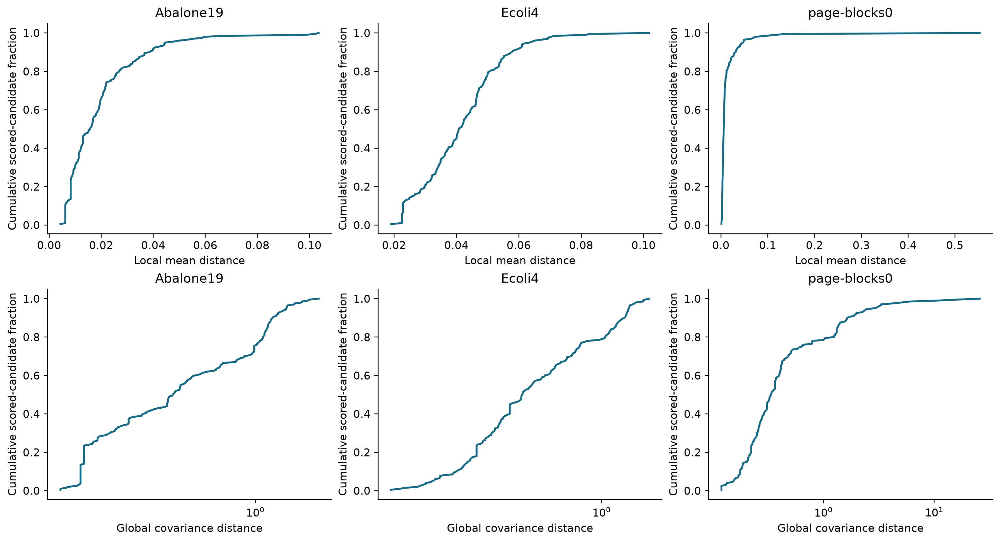
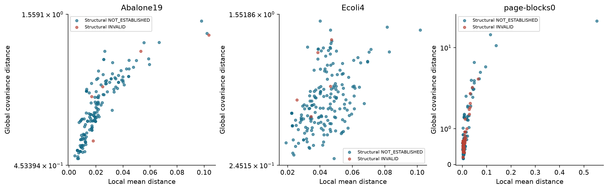
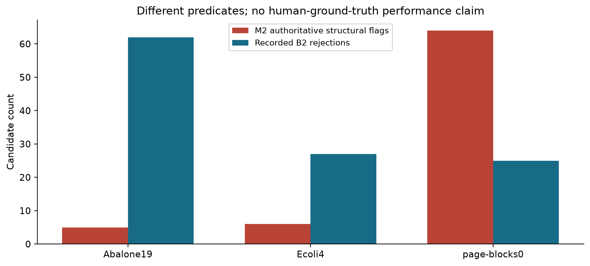
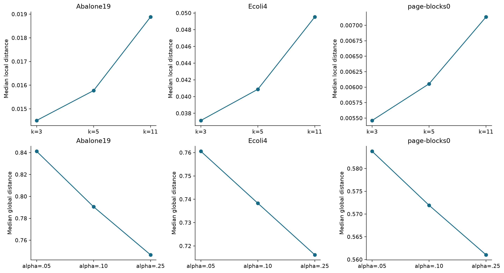

# RC-QASyn Phase-3 M2 exploratory results

Status: implemented engineering and exploratory experiment; human-label evaluation and scientific acceptance pending.

## Motivation and architecture

The aim is complementary interpretable evidence, not a single score or automatic admission. Authoritative structure tests justified source requirements; local mixed-type neighborhoods describe nearby TRAIN support; global shrinkage-covariance distance describes learned cross-feature relationships. Statistical rarity and structural invalidity remain distinct. No superiority, calibrated validity probability or novelty is established by this selected retrospective study.

Phase-2 parent: `6c4634fabd2f8cba2ed7365b0b9559c3df17055a`. Scoring implementation: `6ac352cd5a5e99f0af1aed7a5f1403b9ad3596fe`. Phase-2 human review is unfinished; no scientific freeze is claimed.

The exact equations, authority rules, missingness policy, one-hot encoding, class-support caveats and reproduction commands are in docs/phase3-m2-methods.md. Local distance is the mean k-nearest clipped TRAIN-range-scaled numeric / nominal-mismatch distance. Global distance is the square root of dimension-normalized shrinkage Mahalanobis distance after TRAIN median/IQR scaling and one-hot encoding. There is no cross-family fusion. Class diagnostics are descriptive neighbor fractions, not a fitted classifier.

## Source and experimental design

All 601 historical occurrences are retained: Abalone19 200, Ecoli4 201 and page-blocks0 200. TRAIN references use the frozen source split only. The 120 second-pass proposals were never used to fit models, choose thresholds/configurations or compute ground-truth performance. No REAL TEST value or label enters fitting or configuration selection. Integrity checks read original source files; exact TRAIN subset fingerprints and row IDs are retained with every run.

Five configurations were fixed a priori: k=5/alpha=0.1 baseline; k=3, k=11; alpha=0.05, alpha=0.25. Each produces 1,803 evidence records (601 occurrences x three families). One independent deterministic offline replay matched evidence, fitted parameters and reference identities exactly. Earlier development runs remain preserved; tables below use experiments-v2 exclusively.

## Per-dataset baseline results

| Dataset | Candidates | TRAIN | Structural INVALID | Local available | Global available | Local median | Global median | Rank rho | Tail intersection | Tail disagreement | Structural/B2 disagreement |
| --- | --- | --- | --- | --- | --- | --- | --- | --- | --- | --- | --- |
| Abalone19 | 200 | 3340 | 5 | 200 | 200 | 0.01577 | 0.7906 | 0.9076 | 13 | 14 | 57 |
| Ecoli4 | 201 | 269 | 6 | 200 | 200 | 0.04087 | 0.7383 | 0.4876 | 5 | 30 | 21 |
| page-blocks0 | 200 | 4377 | 64 | 200 | 200 | 0.006054 | 0.5719 | 0.6205 | 19 | 2 | 79 |

Structural INVALID is a source-rule flag, not a human-approved label. NOT_ESTABLISHED is never relabeled VALID. Unavailability is reported rather than imputed. Tail sets use the candidate 90th percentile only for case selection; they are not admission thresholds. Ties can increase their sizes. Rank disagreement demonstrates different views, not proof that one family is correct.

## Recorded baseline behavior comparisons

| Dataset | Control | Local n accepted | Local n rejected | Local median accepted | Local median rejected | Global median accepted | Global median rejected |
| --- | --- | --- | --- | --- | --- | --- | --- |
| Abalone19 | B1 | 200 | 0 | 0.01577 | n/a | 0.7906 | n/a |
| Abalone19 | B2 | 138 | 62 | 0.01915 | 0.008287 | 0.8361 | 0.5636 |
| Abalone19 | B3 | 200 | 0 | 0.01577 | n/a | 0.7906 | n/a |
| Ecoli4 | B1 | 200 | 0 | 0.04087 | n/a | 0.7383 | n/a |
| Ecoli4 | B2 | 174 | 26 | 0.04294 | 0.02289 | 0.7677 | 0.6965 |
| Ecoli4 | B3 | 200 | 0 | 0.04087 | n/a | 0.7383 | n/a |
| page-blocks0 | B1 | 200 | 0 | 0.006054 | n/a | 0.5719 | n/a |
| page-blocks0 | B2 | 175 | 25 | 0.006268 | 0.003938 | 0.5941 | 0.5383 |
| page-blocks0 | B3 | 200 | 0 | 0.006054 | n/a | 0.5719 | n/a |

These are group descriptions under frozen decisions, not accuracy or error estimates. B1 accepts parseable candidates; B2 applies original severity and duplicate checks; B3 is the original single judge. M2 additionally uses source integer declarations and nominal source domains while excluding duplicate-based rejection and requested-class matching as authoritative record truth. These predicate differences explain some disagreement.

## Sensitivity

| Dataset | Configuration | Local median | Global median | Rank rho | Tail disagreement |
| --- | --- | --- | --- | --- | --- |
| Abalone19 | baseline-k5-a10 | 0.01577 | 0.7906 | 0.9076 | 14 |
| Abalone19 | sensitivity-k3 | 0.01451 | 0.7906 | 0.8752 | 16 |
| Abalone19 | sensitivity-k11 | 0.01888 | 0.7906 | 0.9223 | 14 |
| Abalone19 | sensitivity-a05 | 0.01577 | 0.8412 | 0.9173 | 10 |
| Abalone19 | sensitivity-a25 | 0.01577 | 0.7467 | 0.877 | 18 |
| Ecoli4 | baseline-k5-a10 | 0.04087 | 0.7383 | 0.4876 | 30 |
| Ecoli4 | sensitivity-k3 | 0.03714 | 0.7383 | 0.4197 | 30 |
| Ecoli4 | sensitivity-k11 | 0.04953 | 0.7383 | 0.6304 | 28 |
| Ecoli4 | sensitivity-a05 | 0.04087 | 0.7606 | 0.5133 | 30 |
| Ecoli4 | sensitivity-a25 | 0.04087 | 0.7162 | 0.4309 | 34 |
| page-blocks0 | baseline-k5-a10 | 0.006054 | 0.5719 | 0.6205 | 2 |
| page-blocks0 | sensitivity-k3 | 0.005462 | 0.5719 | 0.5965 | 2 |
| page-blocks0 | sensitivity-k11 | 0.007135 | 0.5719 | 0.6797 | 2 |
| page-blocks0 | sensitivity-a05 | 0.006054 | 0.5838 | 0.6504 | 2 |
| page-blocks0 | sensitivity-a25 | 0.006054 | 0.561 | 0.5584 | 4 |

No configuration is selected as a winner. k changes neighborhood scale and duplicate/tie influence; alpha changes regularization of cross-feature relationships. These sensitivities are descriptive and cannot establish human-validity performance without reviewed labels.

## Interpretable cases

| Dataset | Source ordinal | Structural state | Local score | Global score | B2 accepted | B3 accepted |
| --- | --- | --- | --- | --- | --- | --- |
| Abalone19 | 129 | NOT_ESTABLISHED | 0.02567 | 1.228 | True | True |
| Abalone19 | 189 | NOT_ESTABLISHED | 0.02644 | 1.288 | True | True |
| Abalone19 | 106 | NOT_ESTABLISHED | 0.03989 | 1.102 | True | True |
| Abalone19 | 86 | NOT_ESTABLISHED | 0.006203 | 0.5636 | False | True |
| Abalone19 | 197 | NOT_ESTABLISHED | 0.03113 | 1.086 | False | True |
| Ecoli4 | 199 | NOT_ESTABLISHED | 0.04674 | 1.298 | True | True |
| Ecoli4 | 201 | NOT_ESTABLISHED | 0.04642 | 1.415 | True | True |
| Ecoli4 | 197 | NOT_ESTABLISHED | 0.06114 | 0.7346 | True | True |
| Ecoli4 | 78 | NOT_ESTABLISHED | 0.02289 | 0.5871 | False | True |
| Ecoli4 | 32 | NOT_ESTABLISHED | 0.02289 | 0.5871 | False | True |
| page-blocks0 | 85 | NOT_ESTABLISHED | 0.01509 | 1.906 | True | True |
| page-blocks0 | 69 | NOT_ESTABLISHED | 0.03423 | 1.63 | True | True |
| page-blocks0 | 117 | INVALID | 0.005241 | 0.4243 | True | True |
| page-blocks0 | 52 | INVALID | 0.01397 | 0.7488 | True | True |

cases.csv and artifact.json retain full payloads, occurrence IDs, source locators, rule observations and fingerprints. Cases were selected from family-tail disagreement, structural/control disagreement and structural violations with zero local distance. Strong local feature support can coexist with a missing mandatory target or other structural defect. The examples are illustrative, not representative.

## Runtime and reproducibility

| Configuration | Pre-persistence seconds | Evidence rows |
| --- | --- | --- |
| baseline-k5-a10 | 8.747 | 1803 |
| sensitivity-k3 | 8.206 | 1803 |
| sensitivity-k11 | 7 | 1803 |
| sensitivity-a05 | 7.267 | 1803 |
| sensitivity-a25 | 7.838 | 1803 |

Runtime includes source verification, fitting, scoring and summary preparation; excludes final bundle persistence and is an observed workstation measurement rather than a benchmark guarantee. The five runs use deterministic closed-form models; seed 42 is retained but no stochastic estimator consumes it. Environment, model matrices, TRAIN identities and exact configuration are in each sealed result bundle. Replay compares evidence_content_fingerprint, not runtime-bearing outer artifact fingerprints. Run scripts/run_phase3_experiments.py --source-root SOURCE_ROOT; then scripts/report_phase3.py. Render with the recorded Matplotlib version for the same figure environment.

## Limitations and pending decisions

The original target mappings, physical meanings/units and cross-field hard rules remain unresolved. Historical page-blocks0 TRAIN/TEST exact-value overlap remains a limitation. TRAIN duplicates can inflate local support; sparse minority neighborhoods can be unstable. The global elliptical approximation may miss nonlinear/multimodal structure and depend on scaling/regularization. Resubstitution TRAIN tail fractions are not calibrated p-values. The source-selected population and retained 120-row review cohort do not justify population-wide validity claims. Retaining 40 overlap records does not create a second human rater or establish inter-rater agreement.

| Task | Status | Human judgment | Impact | Safely executable |
| --- | --- | --- | --- | --- |
| Accept/correct 120 labels | HUMAN_DECISION_PENDING | Personal inspection and correction of every proposed label | No human precision/recall/F1 permitted | TRAIN-only diagnostics, source/control behavior comparisons |
| Resolve domain semantics | HUMAN_DECISION_PENDING | Original target mappings, physical meanings/units and cross-field requirements | Conservative structure-only validity findings | Statistical support with explicit assumptions |
| Scientifically accept M2 | HUMAN_DECISION_PENDING | Whether these evidence families/assumptions meet research objectives | All results remain exploratory | Preserve/reproduce current diagnostics |
| Independent external verification and final acceptance | HUMAN_DECISION_PENDING | Arrange final scientific verification after supervisor review | No merge/push/freeze | Internal read-only review and final regression |

The complete decision-ledger.csv also records evidence, options and why each decision matters. No human labels or signatures were manufactured. Official B2/B3-versus-human analysis is deferred. Phase-3 engineering completion does not complete Phase-2 human review or scientific acceptance.

## Implemented, exploratory, pending and deferred

Implemented and tested: evidence contracts/registry; three validators; source-bound TRAIN-only runner/readers; determinism, abstention, mixed types, source integrity and held-out perturbation checks. Exploratory: five offline configurations, control/family disagreements and illustrative cases. Pending human-label evaluation: personal correction of 120 labels, explicit reviewed-ledger confirmation, authorized ground-truth evaluation and scientific acceptance. Deferred to Phase 4: calibrated fusion, risk-aware admission, decision thresholds and contribution/selection policies. No Phase-4 implementation, new synthesizer, paid generation, dataset addition or ML migration occurred.
