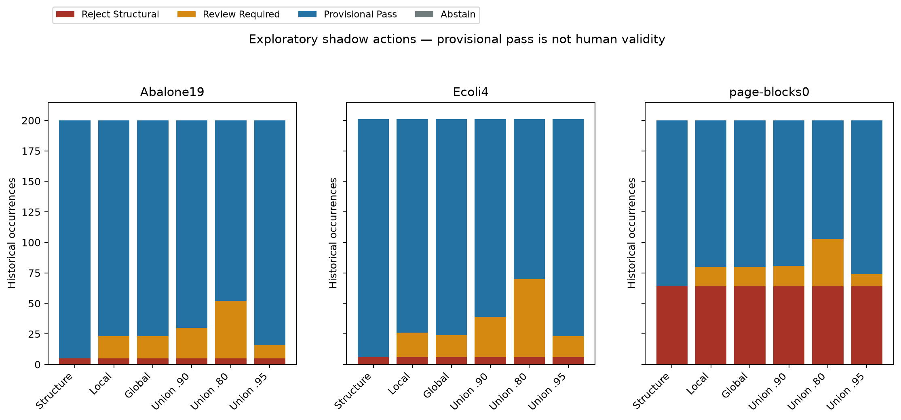
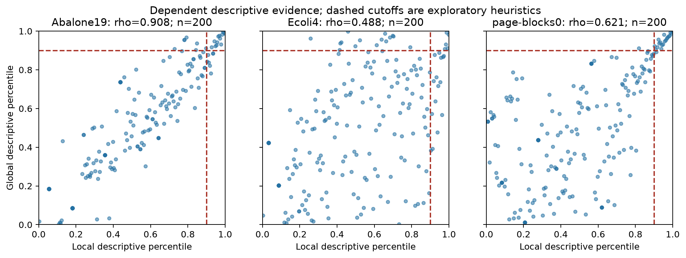
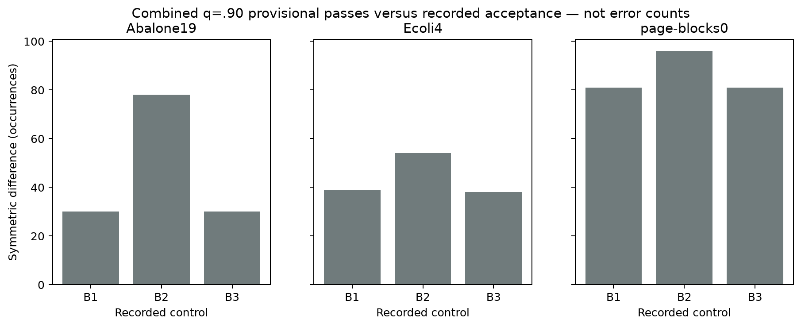
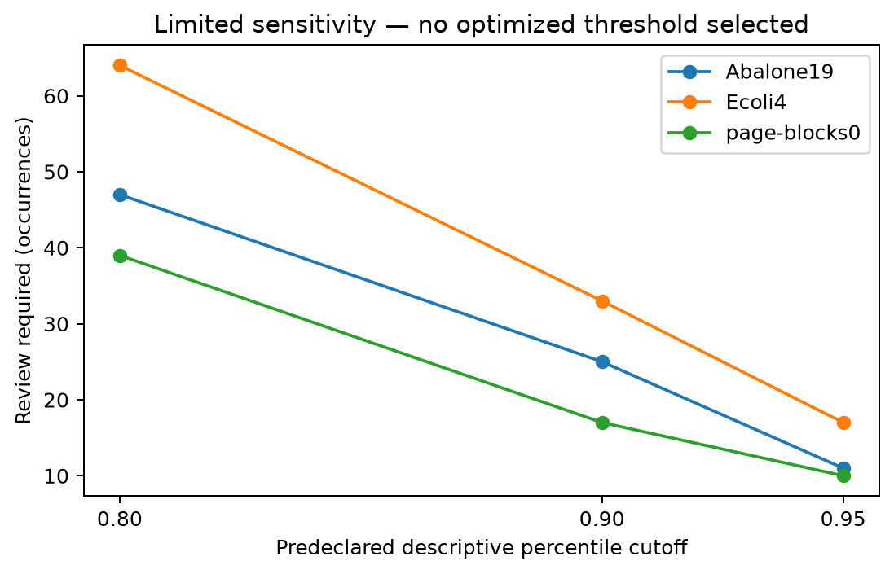

# Phase-4 M4/M5 exploratory shadow results

PHASE-4 ENGINEERING AND EXPLORATORY SHADOW EXPERIMENTS COMPLETE — HUMAN REVIEW PENDING

These are behavior and evidence summaries, not calibrated validation performance. Phase 2 and Phase 3 are not scientifically frozen. No human truth metrics, real calibrator, final accepted dataset or provider calls were produced.

Exact Phase-3 parent: `c47cccb54c2c1cc4f2eff4cb2f83489a0e02b855`. Scoring implementation: `8c44a2fd9438a4b0e6683d9fe7ed515476462e62`.
Plan fingerprint: `2327eab504c6e8b6e572fb1244770df1940a5e9b65f40a70f97fd577ad82bdf8`. M2 input: `3f375c2c6332442c2480bb13e891f71ff5c56500f3aa4daeb305fb173338fdbe`.
Decision content: `890b190fc0d8a7c12fbfdcceff0a0cb6d144245b271b1da1cb57a5974e8407a0`. Vector content: `a5a838cceffd0a5174ef16791e06c532b0f06cafcc2239edd744cce30dd98e4e`.

## Design and mathematical interpretation

See docs/phase4-m4-m5-methods.md (repository root) for every formula, algorithm and reproduction command. Frozen M2 scores are ranked within dataset/family across the frozen generated-candidate population using u=(#lower+0.5*#equal)/n. Larger u means weaker statistical support. This reference includes the focal record and is not TRAIN or REAL TEST. Minimum n=10. Raw scores are preserved. U=max(uL,uG) and I=min(uL,uG) are descriptive and uncalibrated; no independent-evidence multiplication is used. Missing families produce null combined indices.

Structure-only requires no statistical family; local/global require their named family; combined uses a union of concerns u>=0.9. Predeclared q=0.8 and q=0.95 are limited sensitivities. Authoritative structural rejection takes precedence, then required-missing abstention, partial-structure review, statistical review, otherwise provisional pass. PROVISIONAL_PASS is not human-validated VALID. Statistical support never establishes hard invalidity.

## Per-dataset decisions

| Dataset | Policy | N | Structural reject | Review | Provisional pass | Abstain |
| --- | --- | --- | --- | --- | --- | --- |
| Abalone19 | structure-only | 200 | 5 | 0 | 195 | 0 |
| Ecoli4 | structure-only | 201 | 6 | 0 | 195 | 0 |
| page-blocks0 | structure-only | 200 | 64 | 0 | 136 | 0 |
| Abalone19 | local-review | 200 | 5 | 18 | 177 | 0 |
| Ecoli4 | local-review | 201 | 6 | 20 | 175 | 0 |
| page-blocks0 | local-review | 200 | 64 | 16 | 120 | 0 |
| Abalone19 | global-review | 200 | 5 | 18 | 177 | 0 |
| Ecoli4 | global-review | 201 | 6 | 18 | 177 | 0 |
| page-blocks0 | global-review | 200 | 64 | 16 | 120 | 0 |
| Abalone19 | combined-review | 200 | 5 | 25 | 170 | 0 |
| Ecoli4 | combined-review | 201 | 6 | 33 | 162 | 0 |
| page-blocks0 | combined-review | 200 | 64 | 17 | 119 | 0 |
| Abalone19 | combined-review-q80 | 200 | 5 | 47 | 148 | 0 |
| Ecoli4 | combined-review-q80 | 201 | 6 | 64 | 131 | 0 |
| page-blocks0 | combined-review-q80 | 200 | 64 | 39 | 97 | 0 |
| Abalone19 | combined-review-q95 | 200 | 5 | 11 | 184 | 0 |
| Ecoli4 | combined-review-q95 | 201 | 6 | 17 | 178 | 0 |
| page-blocks0 | combined-review-q95 | 200 | 64 | 10 | 126 | 0 |

All policies retain the same 75 authoritative structural rejections (5 Abalone19, 6 Ecoli4, 64 page-blocks0). No statistical-only rejection occurs. Zero realized abstentions does not mean missingness was ignored: Ecoli4 occurrence 181 has no feature evidence but already has a substantiated structural violation, so rejection precedence applies. Both statistical families are available on 600/601 records (200 per dataset); required missingness remains explicit in every decision.

## Dependence and agreement

| Dataset | Paired N | Spearman | Both concerns | Either | Different concern | Tail Jaccard |
| --- | --- | --- | --- | --- | --- | --- |
| Abalone19 | 200 | 0.9076 | 13 | 27 | 14 | 0.4815 |
| Ecoli4 | 200 | 0.4876 | 5 | 35 | 30 | 0.1429 |
| page-blocks0 | 200 | 0.6205 | 19 | 21 | 2 | 0.9048 |

High Abalone19 correlation shows substantial redundancy. Ecoli4 family concerns differ more often. These relationships motivate explicit dependence reporting; they do not measure which family is correct. Counts in this table use all paired-available records before structural precedence, so review totals can be lower than the union count.

## Recorded controls

| Dataset | Control | Recorded accepted | Shadow provisional pass | Symmetric difference |
| --- | --- | --- | --- | --- |
| Abalone19 | B1 | 200 | 170 | 30 |
| Abalone19 | B2 | 138 | 170 | 78 |
| Abalone19 | B3 | 200 | 170 | 30 |
| Ecoli4 | B1 | 201 | 162 | 39 |
| Ecoli4 | B2 | 174 | 162 | 54 |
| Ecoli4 | B3 | 200 | 162 | 38 |
| page-blocks0 | B1 | 200 | 119 | 81 |
| page-blocks0 | B2 | 175 | 119 | 96 |
| page-blocks0 | B3 | 200 | 119 | 81 |

The symmetric difference compares the set of shadow provisional passes with recorded accepted occurrences. It is not an error count. Full per-policy joint action/acceptance tables are in controls.csv and artifact.json. Literal payload-class action counts, including missing class, are in class-breakdown.csv; requested_class is never imputed. Neither controls nor agent labels select these policies. B1/B2/B3 remain unchanged.

## Sensitivity and reproducibility

| Dataset | Sensitivity | Changed actions | N |
| --- | --- | --- | --- |
| Abalone19 | combined-review-q80 | 22 | 200 |
| Ecoli4 | combined-review-q80 | 31 | 201 |
| page-blocks0 | combined-review-q80 | 22 | 200 |
| Abalone19 | combined-review-q95 | 14 | 200 |
| Ecoli4 | combined-review-q95 | 16 | 201 |
| page-blocks0 | combined-review-q95 | 7 | 200 |

Six fixed policies produced 3606 decisions for 601 occurrences. Replay content identical: True. Runtime 7.161 seconds: Source validation plus pure fusion/decisions/summary; excludes persistence/readback and report rendering. Exact action transitions are in sensitivity.csv. Source metadata and dependency versions are in the experiment bundle. Cutoffs were not optimized after observing results.

## Calibration and human dependency

**NOT_ELIGIBLE_UNAPPROVED_LABELS**. All 120 latest labels remain AGENT / PENDING_HUMAN_APPROVAL, with null human-final labels: 0 VALID, 27 INVALID, 93 INDETERMINATE. No real calibrator exists. Future dataset-specific isotonic fitting requires the existing source-bound confirmed human ledger, disjoint calibration/evaluation populations and >=5 scored VALID and INVALID cases in each partition. INDETERMINATE is excluded, never recoded. Synthetic fixtures only exercise this interface; they do not establish real eligibility or population guarantees. Research fingerprints bind content, not human identity; production authentication stays disabled.

## Representative explainable cases

| Dataset | Selection | Source ordinal | Action | Recorded B2 reason |
| --- | --- | --- | --- | --- |
| Abalone19 | structural_rejection | 141 | REJECT_STRUCTURAL | configured deterministic severity rejection |
| Abalone19 | family_concern_disagreement | 8 | REVIEW_REQUIRED | all configured deterministic checks passed |
| Abalone19 | provisional_pass_not_validity | 1 | PROVISIONAL_PASS | all configured deterministic checks passed |
| Abalone19 | structural_B2_behavior_difference | 6 | PROVISIONAL_PASS | duplicate |
| Ecoli4 | structural_rejection | 176 | REJECT_STRUCTURAL | configured deterministic severity rejection |
| Ecoli4 | family_concern_disagreement | 8 | REVIEW_REQUIRED | all configured deterministic checks passed |
| Ecoli4 | provisional_pass_not_validity | 1 | PROVISIONAL_PASS | all configured deterministic checks passed |
| Ecoli4 | missing_statistical_evidence | 181 | REJECT_STRUCTURAL | configured deterministic severity rejection |
| Ecoli4 | structural_B2_behavior_difference | 11 | PROVISIONAL_PASS | duplicate |
| page-blocks0 | structural_rejection | 1 | REJECT_STRUCTURAL | all configured deterministic checks passed |
| page-blocks0 | family_concern_disagreement | 69 | REVIEW_REQUIRED | all configured deterministic checks passed |
| page-blocks0 | provisional_pass_not_validity | 2 | PROVISIONAL_PASS | all configured deterministic checks passed |
| page-blocks0 | structural_B2_behavior_difference | 1 | REJECT_STRUCTURAL | all configured deterministic checks passed |

Cases are deterministic first occurrences satisfying each descriptive selection category, not outcome-balanced exemplars or ground truth. cases.csv includes exact payloads, source identities, normalized/raw evidence, structural reasons and explanations. Multiple categories can show the same occurrence.

## Limitations and pending decisions

The selected cohort is nonrepresentative. Rank references describe the fixed historical candidate population and change with population membership. Unknown original target mappings, physical meanings/units and cross-field rules remain unresolved. Rare/out-of-range/duplicate records are not automatically invalid. Historical TRAIN/TEST exact-value overlap persists; no REAL TEST values were fitted or used for selection. One supervisor review cannot establish inter-rater agreement. Scientific acceptance, reviewed labels, calibration adequacy, official thresholds and final claims remain pending in the single decision-ledger.csv. Dataset contribution/coverage belongs to Phase 5, which is not started.

## Reproduction

Run the commands in docs/phase4-m4-m5-methods.md with fresh versioned output paths. The sealed shadow reader replays decisions and normalization from the frozen M2 bundle. Report rendering uses only saved evidence; its deterministic content can be regenerated without fitting or provider calls. Final verification logs are saved separately under ../final-verification-v1. Prior passing Phase-3 full-suite evidence is retained in the inherited Phase-3 closeout.
