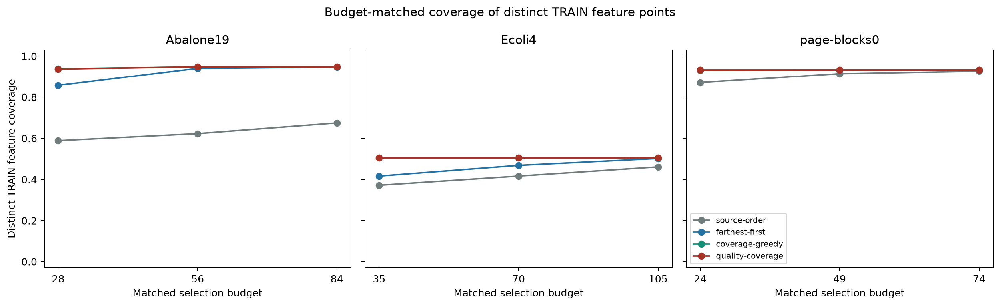
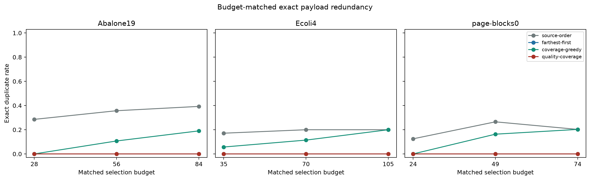
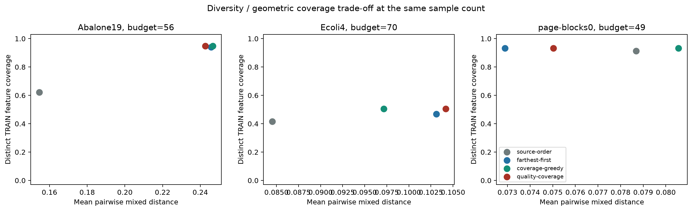
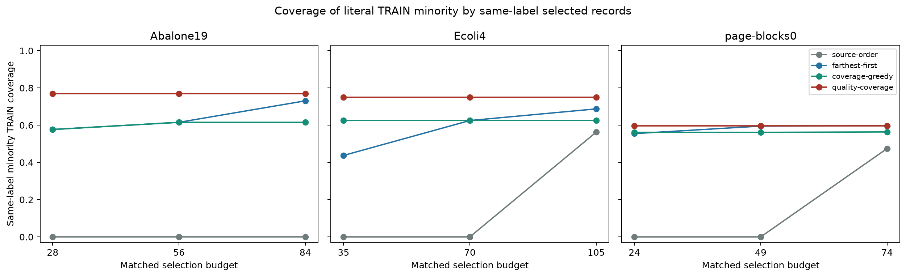

# Phase-5 M7 exploratory dataset construction

PHASE-5 ENGINEERING AND EXPLORATORY DATASET CONSTRUCTION COMPLETE — SCIENTIFIC REVIEW PENDING

Every dataset is provisional, not human-validated ground truth. Better geometric coverage is not proof of record validity, classifier utility, novelty or superiority. Phases 2, 3, 4 and 5 remain scientifically unfrozen.

Exact Phase-4 parent `0a7005e3b36438ba52fa25dd99d9a2b54a1bf1b3`. Construction implementation `00c0eefe2cb447a1616923ff106212061e6ce8b3`.
Study `a9c21ce76dc532de2c3b0e10e7e504385c46ea3bb6c4a5222d417c7bd78757a4`. Deterministic construction content `7ddce7c5530823051743b99c4dfb331bfeac2289586f7c167559f2e63917987f`.

## Architecture and exact methodology

Frozen source occurrences and Phase-4 eligibility feed complete labeled-record checks, reused M2 TRAIN-only mixed distance, four budgeted selectors, immutable original-payload datasets and full deterministic recipe audit. No validator refit, policy rewrite, TEST-driven selection, provider call, human-label fitting or repair occurs.

See docs/phase5-m7-coverage-methods.md at repository root for every formula and reproduction command. Distance is mean clipped TRAIN-range-scaled numeric absolute difference plus nominal mismatch; class is excluded. With r=.05, a TRAIN reference is covered when its minimum selected distance is <=r. Distinct (feature,literal-class) regions prevent duplicate TRAIN rows multiplying selection objectives. Row, distinct-feature and class-balanced coverage are reported separately.

Source-order takes the earliest eligible records. Farthest-first maximizes minimum selected distance after a source-order seed. Coverage-greedy maximizes uniform uncovered-region gain. Quality-coverage retains provisional eligibility, prohibits repeated feature payloads, applies an availability-capped minority quota first, and ranks candidates by class-balanced coverage gain, fewer near neighbors, larger separation, lower uncalibrated concern and stable source order. This is a constrained geometric objective, not calibrated quality optimization.

## Pools and matched budgets

| Dataset | Provisional pool | Distinct feature payloads | Matched budgets |
| --- | --- | --- | --- |
| Abalone19 | 170 | 113 | [28, 56, 84] |
| Ecoli4 | 162 | 141 | [35, 70, 105] |
| page-blocks0 | 119 | 99 | [24, 49, 74] |

Budgets were fixed as floor(.25/.50/.75 times each primary pool's distinct-feature count), before coverage outcomes. The primary pool contains 451 provisional records. Structural rejects, reviews and abstentions remain deferred. Class and every required feature must exist in the original payload; requested_class never repairs a missing class. All four primary strategies use identical per-dataset budgets.

## Main results at the middle matched budget

| Dataset | Strategy | N | TRAIN rows covered | Distinct TRAIN features covered | Exact duplicates | Near duplicates | Same-label minority coverage |
| --- | --- | --- | --- | --- | --- | --- | --- |
| Abalone19 | source-order | 56 | 0.6225 | 0.6225 | 0.3571 | 0.6250 | 0.0000 |
| Abalone19 | farthest-first | 56 | 0.9401 | 0.9401 | 0.0000 | 0.0000 | 0.6154 |
| Abalone19 | coverage-greedy | 56 | 0.9479 | 0.9479 | 0.1071 | 0.2679 | 0.6154 |
| Abalone19 | quality-coverage | 56 | 0.9479 | 0.9479 | 0.0000 | 0.0000 | 0.7692 |
| Ecoli4 | source-order | 70 | 0.4164 | 0.4164 | 0.2000 | 0.3857 | 0.0000 |
| Ecoli4 | farthest-first | 70 | 0.4684 | 0.4684 | 0.0000 | 0.0000 | 0.6250 |
| Ecoli4 | coverage-greedy | 70 | 0.5056 | 0.5056 | 0.1143 | 0.2429 | 0.6250 |
| Ecoli4 | quality-coverage | 70 | 0.5056 | 0.5056 | 0.0000 | 0.0000 | 0.7500 |
| page-blocks0 | source-order | 49 | 0.9146 | 0.9139 | 0.2653 | 0.5918 | 0.0000 |
| page-blocks0 | farthest-first | 49 | 0.9333 | 0.9324 | 0.0000 | 0.0000 | 0.5951 |
| page-blocks0 | coverage-greedy | 49 | 0.9333 | 0.9324 | 0.1633 | 0.4490 | 0.5615 |
| page-blocks0 | quality-coverage | 49 | 0.9333 | 0.9324 | 0.0000 | 0.3265 | 0.5973 |

Rates are fractions. Near-duplicate rate is the share with another selected feature vector within .01 and includes exact feature duplicates. Exact duplicate rate is 1 - unique canonical full payloads / selected count. Minority means least frequent literal TRAIN token, without assuming unknown original target mappings. Same-label minority coverage uses only selected records with that literal class. Complete 51-case metrics are in results.csv and each source dataset artifact, including distance quantiles, pairwise separation, density, concentration, quotas and class breakdowns.

Geometric objectives show trade-offs rather than a guaranteed best method. Uniform and class-balanced region objectives differ. Source duplicates can inflate row coverage without increasing unique-region coverage. Quota constraints can change the order and coverage path. No strategy is selected using TEST or unapproved agent labels.

## Recorded-control intersection and frozen-policy sensitivities

| Dataset | B2 intersection budget | N | TRAIN row coverage | Distinct feature coverage | Exact duplicates |
| --- | --- | --- | --- | --- | --- |
| Abalone19 | 28 | 28 | 0.5901 | 0.5901 | 0.0000 |
| Abalone19 | 56 | 56 | 0.7147 | 0.7147 | 0.0000 |
| Abalone19 | 84 | 84 | 0.9138 | 0.9138 | 0.0000 |
| Ecoli4 | 35 | 35 | 0.3792 | 0.3792 | 0.0000 |
| Ecoli4 | 70 | 70 | 0.4349 | 0.4349 | 0.0000 |
| Ecoli4 | 105 | 105 | 0.4721 | 0.4721 | 0.0000 |
| page-blocks0 | 24 | 24 | 0.8657 | 0.8720 | 0.0000 |
| page-blocks0 | 49 | 49 | 0.9239 | 0.9229 | 0.0000 |
| page-blocks0 | 74 | 74 | 0.9289 | 0.9280 | 0.0000 |

The control is B2-accepted INTERSECT primary provisional eligibility, not raw B2 acceptance. It retains different historical criteria and uses matched budgets. B1/B3 intersections are identical to the main pool on these candidates and need no duplicate experiment. Original B1/B2/B3 records remain unchanged.

| Dataset | Frozen policy | Budget | Eligible | Selected | Jaccard with main D | Distinct feature coverage | Shortfall |
| --- | --- | --- | --- | --- | --- | --- | --- |
| Abalone19 | combined-review-q80 | 56 | 148 | 56 | 0.6000 | 0.9374 | 0 |
| Abalone19 | combined-review-q95 | 56 | 184 | 56 | 0.7231 | 0.9491 | 0 |
| Ecoli4 | combined-review-q80 | 70 | 131 | 70 | 0.5217 | 0.4796 | 0 |
| Ecoli4 | combined-review-q95 | 70 | 178 | 70 | 0.7949 | 0.5093 | 0 |
| page-blocks0 | combined-review-q80 | 49 | 97 | 49 | 0.5312 | 0.8687 | 0 |
| page-blocks0 | combined-review-q95 | 49 | 126 | 49 | 0.7500 | 0.9342 | 0 |

Sensitivities use existing q=.80/.95 decisions; no admission or threshold is overwritten or optimized. Selected-set Jaccard is a stability measure, not correctness. Cross-budget exact-prefix, smaller-set retention and Jaccard are in selection-stability.csv. D can change prefixes as its quota changes with budget.

## Dataset audits and reproducibility

Constructed datasets: 51 (36 primary, 9 control-intersection, 6 policy sensitivity). Full replay identical: True. All source-bound audits PASS. Budget shortfall cases: 0. Measured study runtime: 43.694 seconds, including source preparation, geometry, all constructions, sealed writes and dataset audit replay; excludes report rendering. Per-case runtimes are in artifact.json.

Every bundle preserves ordered original payloads and labels in dataset.csv/JSON, exact source/specification/Phase-4/TRAIN/pool/configuration identities, objective traces, full-source defer ledger, budget/quota accounting and human-review status. The audit reloads source-bound inputs and rebuilds the exact recipe; contradictions fail rather than repair. Audit every constructed dataset with `python -m rcqasyn phase5 audit BUNDLE --source-root SOURCE`. Full commands are in the methods document. Fresh versioned paths reproduce datasets without changing history.

The total selection count across many experiment datasets counts repeated participation; it must not be interpreted as new generated records. Canonical dataset identities are deterministic; manifest runtimes can differ. Study resume validates existing outputs. Source-code content fingerprints normalize newlines for portable checkout identity.

## Explainable cases and limitations

cases.csv records first, largest-marginal-gain and final picks at the middle budgets, deduplicated by selection rank, with original payload, source ordinal, marginal gain, cumulative objective, quota phase and reason. These are deterministic illustrations, not cherry-picked validity demonstrations.

All 120 annotation proposals remain AGENT/PENDING_HUMAN_APPROVAL (0 VALID, 27 INVALID, 93 INDETERMINATE). No real calibration, human-ground-truth performance or utility evaluation is claimed. Unresolved target mappings, physical meanings/units and cross-field rules remain unknown. Selected-cohort bias and historical TRAIN/TEST exact-value overlap remain limitations; TEST values were never consulted by selection. Dense-region concentration and literal-class uncertainty limit interpretation of coverage.

The single decision-ledger.csv records personal label review, domain semantics, radius/quota adequacy, scientific acceptance, future calibration/utility protocol and Phase-6 authorization. Phase 6 is not started. A future bounded-repair study needs an approved edit space, budgets, unchanged originals, edit provenance, re-evaluation and independent scientific assessment.

## Engineering verification

Focused tests, one final full pytest suite, Ruff, Pyright, historical comparisons and the consolidated implementation-owner read-only review are preserved under ../final-verification-v1. This engineering evidence does not constitute scientific acceptance or an independent human validity judgment.
