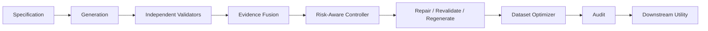

# Architecture

The interfaces are intentionally Protocol-only. A field or record may carry validity,
coherence, and factual evidence; subgroup and dataset evaluations cover fairness,
authenticity, diversity, distributional fidelity, privacy, and downstream utility as
appropriate. Scope is recorded with the evidence/assessment that produced it. Scores
from different dimensions or scopes are not presumed comparable.

| Level | Typical objects and questions |
| --- | --- |
| **FIELD** | schema/constraint validity of one value or column; localized defects |
| **RECORD** | factual validity, logical consistency, semantic coherence, authenticity |
| **SUBGROUP** | fairness, privacy, coverage, and subgroup-specific risk |
| **DATASET** | diversity, distributional fidelity, downstream utility, global audit |

Evidence and assessments must state the evaluated scope; field, record, subgroup, and
dataset measurements are not silently pooled or treated as comparable scores.

M1 implements the executable prefix `Specification → Generation → Independent
Validators → Baseline Decisions → Audit Metrics → Downstream Utility` for three paired
baselines. All three branches consume one persisted raw candidate pool. The profile,
prompt, filter, judge, classifier, and metric stages use TRAIN only; the REAL TEST split
is reserved for final utility evaluation. Evidence fusion, repair/regeneration,
calibration, retrieval/factual verification, and learned control remain future stages.
