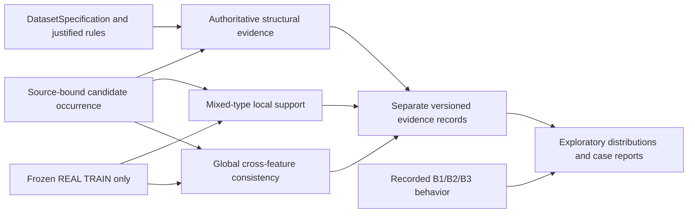

# Phase 3 M2: scoped heterogeneous evidence

## Status and parentage

Engineering and exploratory offline diagnostics extend Phase-2 parent
`6c4634fabd2f8cba2ed7365b0b9559c3df17055a` on the separate branch
`phase3/m2-heterogeneous-evidence`. Phase 2 is not human-reviewed, merged or
scientifically frozen. Phase-1 main remains
`341fc2ce647c180b0f4a34fdbdeb49a0acfdcbcc`. All original artifacts and controls
remain unchanged. Later human corrections can be joined by stable occurrence ID;
no model in this phase fits or tunes against the 120 agent proposals.

The latest second-pass review package is
`artifacts/reports/phase3/review-v2/review.csv` and `review.json`. All 120 remain
AGENT/PENDING_HUMAN_APPROVAL with null human final labels. The complete second
pass retained 0 VALID, 27 INVALID and 93 INDETERMINATE. This is not a claim of
personnel independence, human ground truth or authenticated approval.

## Reference and source contracts

Existing source-bound crosswalks identify 601 physical candidate occurrences:
200 page-blocks0, 201 Ecoli4 and 200 Abalone19. Repeated legacy aliases and equal
payloads remain distinct occurrences. Model inputs are original parsed payloads;
requested_class is conditioning metadata, not an injected target. Evidence
identities bind occurrence ID, canonical payload fingerprint, specification,
TRAIN population, validator version and configuration.

The runner validates the preserved preparation and raw datasets, then selects
only the exact recorded TRAIN row identities. It compares the TRAIN subset
fingerprint against the frozen split before fitting. Whole-source integrity
checks may read TEST bytes; TEST values, labels and statistics do not enter any
fit or configuration selection. Partition validation consults only row IDs.
The REAL TEST perturbation test keeps TRAIN fixed while replacing held-out values
and labels with sentinels: fitted references and evidence must remain identical.

Only the three core datasets are used. No synthesizer, data acquisition,
preprocessing migration, generation seed change or split change is introduced.
A local model may exclude TRAIN rows with absent/nonfinite numeric or non-string
nominal features and reports the excluded count; it never imputes a candidate.
Missing candidate features cause statistical abstention. A missing class still
permits feature-only statistical evidence, with class diagnostics unavailable.

## Evidence architecture

The fixed lightweight registry has three families. Each emits m2-evidence-v1 with
AVAILABLE/PARTIAL/UNAVAILABLE status, raw diagnostic quantities, reason codes,
unsupported fields, reference/configuration/source identities and limitations.
Only structural evidence can substantiate INVALID. No family grants VALID from
absence of violations. Statistical evidence always reports authoritative
validity NOT_ESTABLISHED. There is no cross-family weighted score, calibrated
fusion, admission threshold, selection policy, repair or regeneration.

### Authoritative structure

Compare exact declared feature/target keys, numeric primitive compatibility,
source integer declarations and nominal source categories from DatasetSpecification.
Integer compatibility is mathematical: 10.0 is compatible, 10.1 is not.
The Phase-1 generation prompt explicitly requires class; requested_class is not
substituted. A preserved null is partial evidence, not automatic invalidity.
Absent declared keys, undeclared keys, type violations and unsupported nominal
values are specific structural violations. Source/TRAIN numerical ranges,
rarity, duplicates and physical rules with unresolved semantics never reject.

This family reuses the source specifications that underlie B2; it leaves B2 code,
thresholds and recorded outcomes untouched. Its integer-declaration and nominal
source-domain checks deliberately differ from B2's generic numerical primitive
check and TRAIN categorical domains. It does not import B2's duplicate rejection
or requested-class matching as authoritative truth. Disagreement is therefore
expected and must be interpreted by rule, not called error reduction.

### Local mixed-type neighborhood support

Let T be eligible REAL TRAIN rows, p the number of feature columns, and R_j the
TRAIN max-minus-min span for numeric feature j. Define the numeric contribution

    d_j(x,t) = min(|x_j-t_j|/R_j, 1)         if R_j > 0
             = 1[x_j != t_j]                if R_j = 0

and nominal contribution d_j=1[x_j != t_j]. Distance is

    d(x,t) = (1/p) sum_j d_j(x,t)
    L_k(x) = (1/min(k,|T|)) sum of the nearest min(k,|T|) distances.

This is a clipped, equal-feature-weight Gower-style dissimilarity, not an exact
reproduction of every convention in [Gower (1971)](https://doi.org/10.2307/2528823).
Larger L_k means weaker local support under this chosen metric. TRAIN spans are
scales, not hard validity bounds. No target label enters feature distance.

Numeric constants use match/mismatch; nominal values unseen in TRAIN still have
well-defined mismatch distances and are not thereby invalid. Neighbor ties are
resolved by recorded TRAIN row ID and reported. Feature duplicate count is
separate redundancy information: zero distance is not proof of validity, novelty,
privacy or dataset contribution. Duplicates can inflate local apparent support.

The runner also reports same-declared-class reference count/distance and the
fraction of selected neighbors sharing the literal declared class. These are
uncalibrated descriptive class-support diagnostics, not model probabilities,
original-task semantic verification or a fourth fitted classifier family. Sparse
or absent class references, missing declared classes and distance ties are explicit.

### Global cross-feature covariance consistency

Numeric features use TRAIN median m_j and IQR s_j, falling back to TRAIN span,
then 1 when IQR/span is zero. Encode z_j=(x_j-m_j)/s_j; nominal features use one
indicator for each observed TRAIN category. No ordinal metric is imposed on
nominal tokens. A documented but TRAIN-unseen category makes this family's
learned relationship unavailable; it remains potentially valid structurally.

For encoded dimension q, TRAIN mean mu and sample covariance C (ddof=1), use

    C_alpha = (1-alpha) C + alpha diag(C) + epsilon I
    G(x) = sqrt((z(x)-mu)' inverse(C_alpha) (z(x)-mu) / q).

alpha=0.1 and epsilon=1e-8 are fixed design choices, not label-selected values.
Diagonal shrinkage and ridge improve numerical conditioning of collinear/constant
features. The general motivation is covariance regularization, as discussed by
[Ledoit and Wolf (2004)](https://www.ledoit.net/Well-conditioned2004.pdf); this
implementation is a manually specified diagonal-target shrinkage diagnostic,
not their automatically estimated shrinkage estimator or a novelty claim.

An empirical reference tail fraction is

    (1 + number of TRAIN G(t) >= G(x)) / (|T| + 1).

It uses resubstitution TRAIN scores. It is explicitly descriptive, not a calibrated
p-value, conformal guarantee or probability of validity. The elliptical global
approximation may miss nonlinear/multimodal relationships and be sensitive to
outliers, encoding and regularization. Local and global distances can disagree
without either proving an error. Fewer than two eligible reference rows causes
abstention. No TEST validation, threshold fitting or calibration occurs.

## Offline design and comparisons

`configs/phase3/m2-offline-v1.json` fixes baseline (k=5, alpha=0.1), k=3/11 and
alpha=0.05/0.25 sensitivities before inspecting results. All use the exact same
TRAIN populations and historical candidates. Methods are deterministic closed
form; seed 42 is recorded for experiment identity but no stochastic estimator
or resampling consumes it. No seed derivation used by historical controls changes.

Report per-family distributions, availability and example cases. Compare raw
scores grouped by original B1/B2/B3 admission decisions and structural-predicate
set disagreement. These are behavior comparisons, not human-ground-truth
performance. Compare local/global Spearman rank correlation and upper-decile
candidate score sets solely to choose interpretable examples. Candidate q90 is
not a fitted admission threshold and ties may expand those case-selection sets.
Do not call these analyses precision, recall, F1, superiority or validated truth.

Frozen controls remain untouched: B1 accepts parsed objects, B2 applies its
original deterministic severity/duplicate policy, and B3 uses its recorded single
judge outcome. Missing class records can receive B1/B3 acceptance even though
the actual generator contract requires class. This is an evidence disagreement,
not permission to rewrite the records or controls.

## Storage and reproduction

Run from this worktree with Python 3.12 and its src on PYTHONPATH. The source-root
argument points to preserved main evidence/raw data. Example:

    python -B -m rcqasyn phase3 score artifacts/reports/phase3/experiments-replay-VERSION/baseline-k5-a10 --source-root SOURCE_ROOT
    python -B -m rcqasyn phase3 inspect artifacts/reports/phase3/experiments-replay-VERSION/baseline-k5-a10

Additional configurations use --k and --shrinkage. Outputs are new immutable
versions under artifacts/reports/phase3. The guarded existing writer reserves and
seals JSON/CSV. Readers recheck the seal, schema, exact occurrence/family coverage,
payload/specification/reference/configuration bindings and uniqueness.

Model parameters, exact TRAIN row IDs/fingerprints, dependency versions,
configuration and implementation revision are stored. Evidence rows and their
content fingerprint are deterministic; wall-clock runtime intentionally is not.
Replay into a fresh output path and compare evidence_content_fingerprint, not the
runtime-bearing outer artifact fingerprint. Run the plotting/report script with
the optional research dependency (Matplotlib) to regenerate figures from saved
results; plotting never refits models or selects configurations.

## Deferred decisions and scientific acceptance

HUMAN_DECISION_PENDING: personal review/correction of all 120 proposed labels;
original target mapping/physical-unit/cross-field questions; scientific acceptance
of M2 diagnostics; approval for later human-label evaluation. The separate
decision ledger states evidence, options, impact and safely executable work.
No human approval record is manufactured. Phase 4 retains calibrated fusion,
risk-aware admission, dataset contribution/selection policies and decision tuning.
A dedicated fitted class-compatibility classifier, nonlinear density models and
additional datasets are outside this compact M2 implementation.

## Final artifact map

- Latest supervisor sheet: artifacts/reports/phase3/review-v2/review.csv and review.json.
- Final diagnostic configuration set: artifacts/reports/phase3/experiments-v2/manifest.
- Final exploratory narrative and four PNG/SVG figure sets:
  artifacts/reports/phase3/m2-report-v2/report.md.
- Human dependency ledger: artifacts/reports/phase3/m2-report-v2/decision-ledger.csv.
- Earlier experiments and report-v1 remain preserved development artifacts.

No cross-family fusion or admission node exists. REAL TEST does not feed fitting.
Human-reviewed labels can later be joined by occurrence identity for separately
authorized evaluation; refitting diagnostics is not required merely to correct
agent labels. No personal label approval has been transcribed or inferred.
